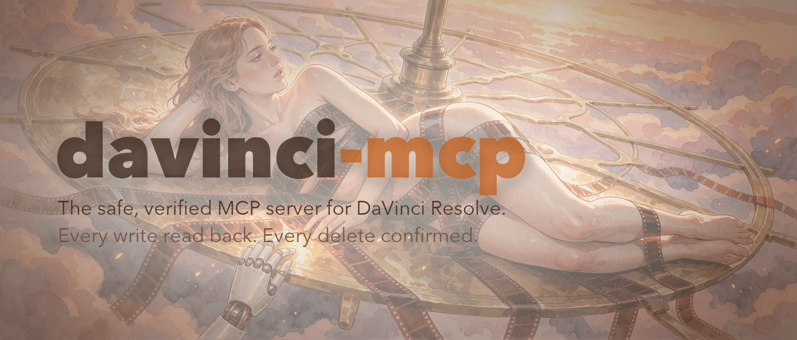
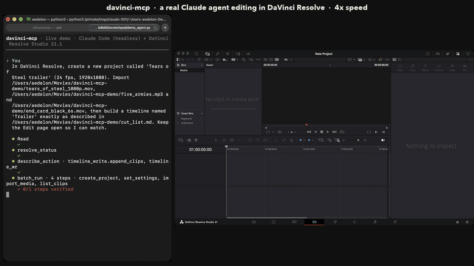
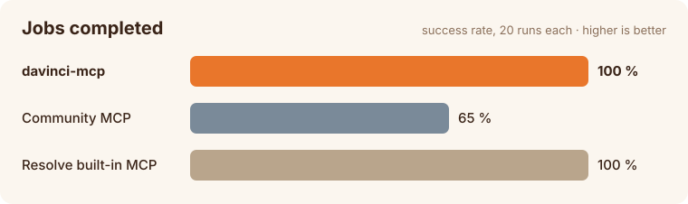
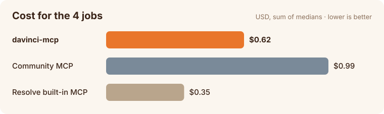
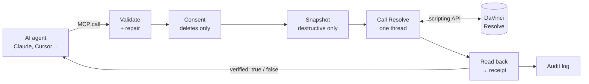

<!-- mcp-name: io.github.Aedelon/davinci-mcp -->

<p align="center">
  
</p>

<p align="center">
  <a href="https://github.com/Aedelon/davinci-mcp/actions/workflows/ci.yml"></a>
  <a href="https://pypi.org/project/davinci-mcp/"></a>
  
  
  
  
  <a href="https://glama.ai/mcp/servers/Aedelon/davinci-mcp"></a>
  <a href="https://ko-fi.com/aedelon"></a>
</p>

<p align="center"><b>Let an AI agent edit, grade and deliver in DaVinci Resolve, with every change checked.</b></p>

---

davinci-mcp is an [MCP](https://modelcontextprotocol.io) server for **DaVinci Resolve**. It gives AI agents such as Claude access to the whole Resolve scripting API: 299 typed actions across 17 domains. Every change is **verified against Resolve itself** before it is reported as done.

It is built for **editors and colorists** who want an assistant that does the clicking, and for **developers** who want a dependable bridge between an agent and Resolve.

## See it work

A real Claude agent, given four plain messages, cut this 52-second action trailer from the open movie *Tears of Steel*. It imported the footage, laid out 33 shots on the beat, added the title cards, graded teal and orange, and rendered it. Nothing in the run was staged; the video below is sped up 4×.

<p align="center">
  <a href="https://www.youtube.com/watch?v=iT-ptK_Gx-g"></a>
  <br><sub><a href="https://www.youtube.com/watch?v=iT-ptK_Gx-g">▶ Watch the full demo on YouTube (39 s)</a></sub>
</p>

<p align="center">
  <a href="https://www.youtube.com/watch?v=epndWG8TqFM"></a>
  <br><sub><a href="https://www.youtube.com/watch?v=epndWG8TqFM">▶ Watch the trailer the agent cut on YouTube (52 s)</a></sub>
</p>

## Why davinci-mcp

**Verified, not hopeful**
- Every write is read back from Resolve, and its receipt says `verified: true` or `false`. An agent can't claim a change that didn't happen.
- `dry_run` previews any write without applying it.
- Deletes need consent: the first call returns a plan and a `confirm_token`, and nothing is removed until the same call comes back with the token.
- Destructive edits take a safety snapshot of the timeline first.
- Every call is written to a JSONL audit log.

**Reliable**
- In the benchmark below, 20 of 20 jobs passed. The community MCP server passed 13 of 20, davinci-mcp-professional 10 of 20.
- Near-miss parameters are repaired instead of refused (`fade_out` → `FadeOut`, a bare clip name → a selector), and every rewrite is reported.
- Errors are actionable: they suggest the right field ("did you mean"), name the right tool, and say which render setting Resolve rejected.

**Economical**
- `batch_run` chains a whole sequence server-side in one call, for example 18 steps from timeline to render.
- Clients defer the tools, so the first turn costs about 32k tokens of context.
- Replies and schemas are compact. Against the community server: **31 % cheaper** and **60 % fewer calls**.

**Exhaustive and extensible**
- 17 domains: project, media, timeline, item, color, Fusion, gallery, audio, render, interchange, AI tools, UI, app and more.
- One-call workflows: `conform_from_edl`, `deliver`, `build_vertical_reel`, `apply_look`, `title_overlay`.
- Your own [recipes](https://github.com/Aedelon/davinci-mcp/blob/main/docs/recipes.md): YAML templates, plus Python when you opt in.

**Safe by default**
- File access is limited to the folders you allow.
- The server's own state, its configuration and your Claude configuration files are always off-limits.
- Symlinks are never followed when importing a folder.

## Benchmarks

Headless Claude agents (Sonnet) ran four post-production jobs on a live Resolve Studio 21.1, five runs each. An agent that never saw the server's code wrote the jobs:
- **dailies**: log and organise a day of footage;
- **promo**: build a promo with a music bed;
- **look**: grade with versions and a still;
- **spot QC**: duplicate, export interchange files and render a range.

Each check reads Resolve directly, never through the server under test. Every agent ran under the same isolated harness. [Full method and history →](https://github.com/Aedelon/davinci-mcp/blob/main/eval/RESULTS.md)

<p align="center">
  
  
</p>

| Server | Jobs passed | Tool calls | Cost (4 jobs) |
|---|---|---|---|
| **davinci-mcp** | **20 / 20** | 35 | $0.62 |
| Community MCP ([samuelgursky/davinci-resolve-mcp](https://github.com/samuelgursky/davinci-resolve-mcp)) | 13 / 20 | 90 | $0.99 |
| MCP Professional ([hoyt-harness/davinci-mcp-professional](https://github.com/hoyt-harness/davinci-mcp-professional)) | 10 / 20 | 156 | $1.04 |
| Resolve's built-in MCP | 20 / 20 | 17 | $0.35 |

**About the built-in server.** Resolve 21.1 ships its own MCP server, which is cheaper because it hands the agent one tool, `run_script_unsafe`, to run arbitrary Python inside Resolve. That makes for short runs, but nothing is validated, read back, audited, snapshotted or confirmed before a delete. In our scale test (160 clips, 4 timelines) it once put a marker at the wrong frame, then reported the job done. davinci-mcp trades a little cost for changes you can trust.

## Talk to it like an editor

```text
Import the clips in ~/Footage/day03, sort interviews and B-roll into bins, and colour the circled takes green.
```
```text
Build a 9:16 reel from these three shots, add subtitles from the audio, and render it for Instagram.
```
```text
Conform this EDL against the media in ~/Rushes and deliver a ProRes master and an H.264 proxy.
```
```text
Apply the show LUT to every shot of the timeline except the end card, and grab a still of the first shot.
```
```text
Add a red marker at the start of every shot named "broll_" in Edit_03.
```
```text
Duplicate the approved cut as "QC", export it as FCPXML and OTIO, and render 01:00:02:00 to 01:00:07:24.
```

## How it works



1. **Validate.** The agent calls a domain tool such as `timeline_write` with `{"op": {"action": ..., ...}}`, and the parameters are checked against a typed schema. Almost-right parameters are repaired, and each repair is reported.
2. **Consent and snapshot.** Deletes stop at a plan until they are confirmed, and destructive edits take a snapshot first.
3. **Call Resolve.** The call runs on a single executor thread, the only place Resolve is ever called from.
4. **Read back.** The server reads the result back from Resolve and returns a receipt with `verified`. Long renders become jobs that the agent can wait on.


## Tools

52 tools. Domain tools are named `<domain>_read`, `<domain>_write` and `<domain>_delete`, and take `{"op": {"action": ..., ...}}`; together they expose about 300 actions. Reads have no side effects, writes return a verified receipt, deletes ask for confirmation first.

- `resolve_status` - Connection state, Resolve version and edition, current project, timeline and page.
- `describe_action` - Compact parameter schemas of one or several actions.
- `search_api` - Search the Resolve 21.1 scripting API by name or description.
- `batch_run` - Run several tool calls in one call, server-side, with one confirmation for the batch.
- `workflow_write` - One-call jobs: `conform_from_edl`, `deliver`, `build_vertical_reel`, `apply_look`, `title_overlay`.
- `recipe_list` / `recipe_run` - List and run YAML or Python recipes; every step is validated, verified and audited.
- `project_read` / `project_write` / `project_delete` - Projects, folders, databases, settings and settings presets; create, load, save, archive, import, export.
- `media_read` / `media_write` / `media_delete` - Media pool and storage: import, bins, relink, proxies, metadata, markers, flags, multicam, mattes, audio sync.
- `timeline_read` / `timeline_write` / `timeline_delete` - Timelines, tracks, markers, playhead, compound and Fusion clips, import and export.
- `item_read` / `item_write` / `item_delete` - Timeline items: properties, speed, fades, takes, flags, colors, markers, transitions, stabilization.
- `color_read` / `color_write` / `color_delete` - Node graphs, CDL, LUTs, versions, color groups, DRX grades, DCTL.
- `fusion_read` / `fusion_write` / `fusion_delete` - Fusion comps and tools: add, connect, inputs, keyframes, expressions, Text+ titles, settings, fuses.
- `gallery_read` / `gallery_write` / `gallery_delete` - Still albums: grab, import, export, label.
- `audio_read` / `audio_write` - Loudness analysis, silence detection, normalization, voice isolation, Fairlight presets, audio mapping.
- `render_read` / `render_write` / `render_delete` - Formats, codecs, presets and render jobs; render a timeline or a range, Quick Export.
- `interchange_read` / `interchange_write` - EDL, FCPXML, OTIO, marker CSV and .cube LUT files, read and written without Resolve.
- `ai_read` / `ai_write` / `ai_delete` - Transcription, subtitles from audio, scene-cut detection, Smart Reframe, audio classification, IntelliSearch.
- `vision_read` - Export or screenshot frames and contact sheets so the agent can look at the picture.
- `ui_read` / `ui_write` / `ui_delete` - Pages, menus and keyboard shortcuts, for the few things the API can't do.
- `app_read` / `app_write` / `app_delete` - Resolve app info, layout presets, keyframe mode, quit.
- `snapshot_list` / `snapshot_write` - Safety copies of the timeline or project, taken automatically before destructive edits.
- `job_status` / `job_wait` / `job_list` / `job_cancel` - Long operations (renders, analyses) run as jobs.
- `code_delete` - `run_lua` and `run_python` inside Resolve, an escape hatch that is off by default and always asks for confirmation.

## Install

<details open>
<summary><b>Requirements</b></summary>

- **DaVinci Resolve Studio 21.1 or later.** In *Preferences → General → External scripting using*, choose **Local**.
- **The free edition 21.1+ is not supported.** Resolve 21.1 took Python scripting out of the free edition, and its Lua sandbox can't reach the Resolve API (tested on 21.1.2). On the free 21.0.x, the in-app bridge should still work: run `davinci-mcp install --bridge`, then start it from *Workspace → Scripts*.
- **Python 3.13+** and [uv](https://docs.astral.sh/uv/) (or pipx / pip).
</details>

```bash
uv tool install davinci-mcp
```

`pipx install davinci-mcp` and `pip install davinci-mcp` work too.

```bash
davinci-mcp doctor
```

`doctor` checks that Resolve is reachable and reports its version, edition and channel.

<details>
<summary><b>Claude Code</b></summary>

```bash
davinci-mcp install --target claude-code
```

Or add it by hand:

```bash
claude mcp add davinci-mcp -- davinci-mcp serve
```
</details>

<details>
<summary><b>Claude Desktop</b></summary>

```bash
davinci-mcp install --target claude-desktop
```

This adds the server to `claude_desktop_config.json`. Restart Claude Desktop to load it. To do it by hand:

```json
{
  "mcpServers": {
    "davinci-mcp": { "command": "davinci-mcp", "args": ["serve"] }
  }
}
```

If Claude Desktop can't find the command, use its absolute path (`which davinci-mcp`).

Without installing anything, any client can run it through uvx: `{ "command": "uvx", "args": ["davinci-mcp", "serve"] }`. Don't run `uvx davinci-mcp install`: it would write a path from uv's temporary cache into the client config.
</details>

<details>
<summary><b>Cursor</b></summary>

In `~/.cursor/mcp.json`:

```json
{
  "mcpServers": {
    "davinci-mcp": { "command": "davinci-mcp", "args": ["serve"] }
  }
}
```
</details>

<details>
<summary><b>VS Code</b></summary>

In `.vscode/mcp.json`:

```json
{
  "servers": {
    "davinci-mcp": { "type": "stdio", "command": "davinci-mcp", "args": ["serve"] }
  }
}
```
</details>

<details>
<summary><b>Any other MCP client</b></summary>

Run `davinci-mcp serve` over stdio. Use `davinci-mcp serve --transport http` for Streamable HTTP; it binds to loopback and needs a bearer token for any other host. The server also exposes a `davinci://status` resource.
</details>

## Configure

The optional file `~/.config/davinci-mcp/config.toml` holds the settings. Any key can be overridden with a `DAVINCI_MCP_<SECTION>__<KEY>` environment variable.

```toml
[safety]
allowed_roots = ["~/Movies", "~/Projects"]  # files outside these are refused (default: your home)
auto_snapshot = "destructive"               # "off" | "destructive" | "all"

[recipes]
allow_python = false                        # Python recipes run arbitrary code: opt in
```

The file does not exist until you create it; without it the defaults below apply. Unknown keys, or keys in the wrong section, stop the server with a validation error. In an environment variable a list is written `[~/Movies,~/Footage]`.

<details>
<summary><b>All settings</b></summary>

| Key | Default | Meaning |
|---|---|---|
| `state_dir` (top level) | `~/.local/state/davinci-mcp` | Audit log, jobs, confirm tokens, temporary frames. |
| `connection.auto_launch` | `true` | Start Resolve when it is not running. |
| `connection.headless` | `false` | Launch Resolve with `-nogui`. |
| `connection.call_timeout_s` | `30` | Maximum seconds for one Resolve API call. |
| `connection.launch_timeout_s` | `90` | Maximum seconds to wait for Resolve to start. |
| `connection.script_api`, `connection.script_lib` | auto-detected | Paths to Resolve's scripting modules, only if detection fails. |
| `safety.allowed_roots` | `["~"]` | Folders tools may read or write; anything else is refused. |
| `safety.auto_snapshot` | `"destructive"` | When snapshots are taken unasked: `"destructive"`, `"all"` or `"off"`. A call can force it with `snapshot`. |
| `safety.snapshot_dir` | `<state_dir>/snapshots` | Where project exports (`.drp`) are written. |
| `safety.snapshot_retention` | `20` | Snapshots kept per project; older ones are pruned. `0` keeps none. |
| `safety.consent_ttl_s` | `300` | Lifetime of a `confirm_token`, in seconds. |
| `safety.enable_code_execution` | `false` | Allow arbitrary Python/Lua (`code_delete`) and Fusion scripts. This code runs with your user rights, outside `allowed_roots`. |
| `http.host`, `http.port` | `127.0.0.1`, `8765` | Address for `serve --transport http`. Any non-loopback host requires a token. |
| `http.token_env` | `DAVINCI_MCP_TOKEN` | Name of the environment variable holding the bearer token. |
| `server.schema_mode` | `"compact"` | `"full"` lists every action's complete schema in `tools/list` (much larger). |
| `recipes.dirs` | `["~/.config/davinci-mcp/recipes"]` | Folders of user recipes (see [recipes](https://github.com/Aedelon/davinci-mcp/blob/main/docs/recipes.md)). |
| `recipes.allow_python` | `false` | Load `*.py` recipes, which run arbitrary code. |

</details>

## FAQ

<details>
<summary><b>The agent says it cannot reach Resolve</b></summary>

Check three things:
- Resolve is running;
- in Studio, *External scripting using* is set to **Local**;
- no dialog is open in Resolve, such as an update prompt or a project manager.

Then run `davinci-mcp doctor`.
</details>

<details>
<summary><b>Does it work with the free edition?</b></summary>

Not from 21.1 on. Resolve 21.1 removed both external scripting and in-app Python scripts from the free edition. In-app Lua scripts still run, but in a sandbox with no file access, no network and no access to the Resolve API (tested on free 21.1.2), so no bridge can work there. On the free 21.0.x, the in-app Python bridge (`davinci-mcp install --bridge`) should still work. Otherwise you need Resolve Studio.
</details>

<details>
<summary><b>Can it delete my work?</b></summary>

Not without consent. Every delete returns a plan first and needs a matching `confirm_token`. Destructive edits snapshot the timeline, and every call is logged.
</details>

<details>
<summary><b>Will it touch files outside my projects?</b></summary>

Only inside `allowed_roots`. The server's own state, its configuration and your Claude configuration files are always refused, whatever you allow.
</details>

<details>
<summary><b>Why is the built-in Resolve MCP cheaper?</b></summary>

It runs one unchecked Python script per job. davinci-mcp makes typed, verified calls, so it uses a few more steps. `batch_run` and the one-call workflows keep that overhead small.
</details>

## Contributing

Issues and pull requests are welcome. [docs/domain-guide.md](https://github.com/Aedelon/davinci-mcp/blob/main/docs/domain-guide.md) shows how to add an action: a parameter model, a handler, a read-back check and a test. The rest is generated from there.

```bash
uv sync
uv run pytest
uv run ruff check . && uv run pyright
```

## Credits

- Demo footage: *Tears of Steel*, © Blender Foundation | [mango.blender.org](https://mango.blender.org), CC-BY 3.0.
- Demo music: *Five Armies* by Kevin MacLeod ([incompetech.com](https://incompetech.com)), CC-BY 4.0.

davinci-mcp is an independent project. It is not affiliated with, endorsed by or sponsored by Blackmagic Design. DaVinci Resolve is a trademark of Blackmagic Design Pty. Ltd.

## Support

davinci-mcp is free and open source. If it saves you time in the edit, you can buy me a coffee:

<a href="https://ko-fi.com/aedelon"></a>

Made by Delanoe Pirard (Aedelon) · Apache 2.0
